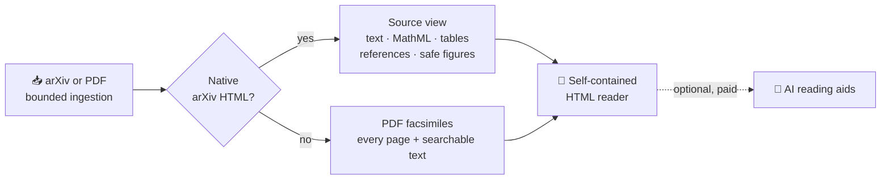
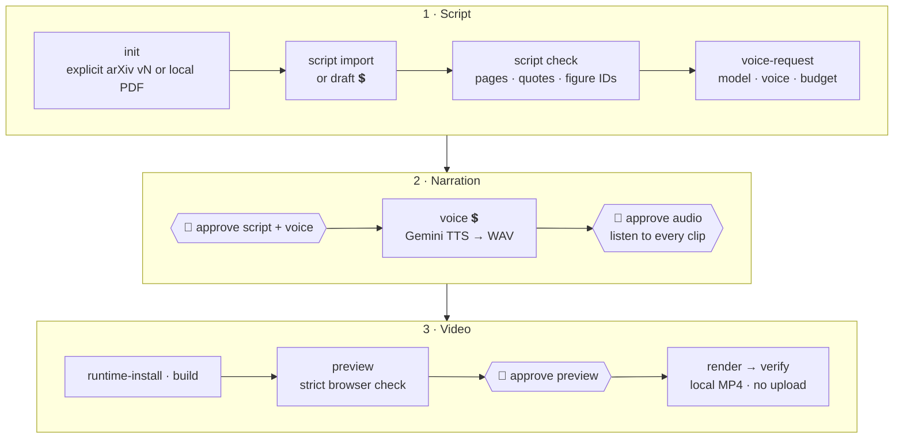

<div align="center">


# paper2html

**Turn research papers into complete, self-contained HTML readers and source-grounded narrated videos.**

[](https://github.com/JewelsHovan/paper2html/actions/workflows/checks.yml)
[](LICENSE)


[Quick start](#quick-start) · [Try it with an agent](#try-it-with-an-agent) · [How it works](#how-it-works) · [Narrated videos](#narrated-videos) · [Docs](#documentation)

</div>

---

paper2html converts an arXiv paper or local PDF into a single HTML file that keeps the **entire original paper**, including text, equations, tables, figures, and references. It does not replace the paper with a summary. The same CLI also runs a staged, approval-gated workflow that turns the paper into a narrated video built from its original figures.

People can run the CLI directly, or have an agent in any harness run it for them. Agents use the same commands as people.

| | What you get | Cost | Requirements |
| --- | --- | --- | --- |
| 📄 **HTML reader** | The full paper as one offline HTML file, with native math, tables, and embedded figures | Free, with no model calls | Python 3.11+, Cairo |
| 🧠 **Reading aids** | Optional AI section summaries and figure notes alongside the original | Paid, with an estimated budget | Claude or OpenAI key |
| 🎬 **Narrated video** | A source-cited script, Gemini narration, captions, and a local MP4 | Paid, approved stage by stage | Node 22+, FFmpeg, Gemini key |

## Quick start

```bash
git clone https://github.com/JewelsHovan/paper2html.git
cd paper2html
uv sync --frozen --no-dev --extra browser
uv run --frozen --no-dev playwright install chromium   # Linux: add --with-deps

# Convert a paper. No API key, no model calls.
uv run --frozen --no-dev paper2html process https://arxiv.org/abs/1706.03762 --source-only -o attention.html
open attention.html   # Linux: xdg-open
```

You'll need Python 3.11+, [uv](https://docs.astral.sh/uv/getting-started/installation/), and native Cairo for SVG figures (`brew install cairo`, `sudo apt install libcairo2`, or `sudo dnf install cairo`). To install with pip instead, see the [installation guide](docs/installation.md).

> [!TIP]
> On Apple Silicon, if Cairo can't be found, run `export DYLD_FALLBACK_LIBRARY_PATH=/opt/homebrew/lib`.

## Try it with an agent

Clone or download this repository, open it in your agent's workspace (Claude Code, Codex, Cursor, Compass, or any other harness), and paste the prompt below. Replace the `PAPER` line first. The agent reads [`AGENTS.md`](AGENTS.md) and the CLI's built-in instructions, so it doesn't need any plugin or skill.

```text
You are working in a checkout of the paper2html repository.

PAPER: https://arxiv.org/abs/XXXX.XXXXX   (or a path to a local PDF)
GOAL:  A complete HTML reader of the paper. Then, only if I agree, a narrated video.

1. Read AGENTS.md, README.md, docs/installation.md, docs/agents.md and docs/video.md.
2. Set up with `uv sync --frozen --no-dev --extra browser`. Ask me before installing
   anything else, including Chromium, system packages, Node packages or the video renderer.
3. Run `uv run --frozen --no-dev paper2html --help`, `... video --help` and
   `... video instructions`. Use the documented commands; never guess flags.
4. Build the free reader with `paper2html process PAPER --source-only -o outputs/<name>.html`.
   Report every warning. Check it against the original paper: all sections, equations,
   tables, figures and references must be present. Tell me about anything missing or reflowed.
   A successful command alone does not prove the paper is complete.
5. Stop and summarize. Ask whether I want the video.
6. For the video, use `paper2html video` with a new project under outputs/ and JSON status.
   Use an explicit arXiv revision (vN). Stop for my decision at every gate:
   - before any paid call: show the model, my reviewed prices and the estimated budget;
   - before narration: show the full script, its source citations and the chosen voice;
   - before rendering: give me the preview to watch and listen to.
   Never approve on my behalf, edit state files to get past a gate, or retry a failed
   or unknown-billed request. Budgets are estimates, not invoices.
7. Verify the rendered MP4, and show me sample frames from the encoded file.
8. Never print API keys, upload or publish anything, commit, or delete my files.
   Keep generated files in outputs/.
```

To get only the HTML reader, stop after step 5. More detail is in the [agent guide](docs/agents.md).

## How it works



| Source | How it's preserved |
| --- | --- |
| **arXiv with native HTML** | The article, in its original order: front matter, inline math as MathML, captions, tables, and references |
| **SVG figures** | Validated and rasterized safely, with no scripts, external fetches, or active content |
| **LaTeXML labelled figures** | Rendered by an optional offline Chromium backend that runs with JavaScript disabled |
| **PDF-only papers** | A full facsimile of every page, vector graphics included, plus separate searchable text |

Anything the converter can't support is reported as an explicit warning instead of being dropped. See [source fidelity](docs/source-fidelity.md) and the published validation reports ([2511.12723](docs/validation-2511.12723.md), [2610.05140](docs/validation-2610.05140.md)).

## Narrated videos

`paper2html video` is a resumable, staged pipeline. Each stage is a separate command, and every paid or irreversible step waits for a person to approve it.



💲 marks a paid stage. 👤 marks a decision that only a person can make.

| Guarantee | How it's enforced |
| --- | --- |
| **Grounded script** | Every claim must cite a real PDF page and a verbatim quote; native figure and table IDs are checked |
| **No surprise spending** | Paid stages need `--consent`, prices you've reviewed, and request and run budgets. Unknown model prices block |
| **No blind retries** | A receipt is written before each paid request. Failed or unknown-billed requests are never retried automatically |
| **Fresh approvals** | Approvals are bound to file hashes. Editing the script, audio, assets, or runtime invalidates the approvals that depend on them |
| **Agent-safe output** | JSON by default, `error_code` and `next_actions`, exit 2 when blocked, and credentials redacted |
| **Local only** | There is no upload command. The renderer is a pinned, project-local [HyperFrames](https://www.npmjs.com/package/hyperframes) install |

```bash
uv run --frozen --no-dev paper2html video doctor --json     # what's installed; offline
uv run --frozen --no-dev paper2html video instructions      # the full operating contract
```

> [!NOTE]
> The generic video CLI is **experimental**. It's tested offline with fixtures and mocked providers. Live provider behavior and video quality for any particular paper aren't guaranteed. Automated checks confirm structure and grounding, not scientific truth, so read the script and watch the preview yourself. See the [video guide](docs/video.md).

## Command reference

| Command | Purpose |
| --- | --- |
| `paper2html process SOURCE --source-only -o OUT.html` | Free, complete HTML reader |
| `paper2html [global options] process SOURCE` | Reader plus paid AI reading aids |
| `paper2html list` · `paper2html open ID` | Browse your local library |
| `paper2html cache clear [--scope responses\|ingestion\|all]` | Clear caches, never your outputs |
| `paper2html video --help` | Staged narrated-video workflow |

Global options (`--provider`, `--model`, `--max-cost-usd`, and others) go **before** `process`. Options like `--source-only`, `-o`, and `--overwrite` go **after** it. The complete option table, safety limits, cache layout, and provider interface are in the [reference](docs/reference.md).

## Safety at a glance

| Area | Behavior |
| --- | --- |
| **Fidelity** | Missing or unsupported content produces a warning. A zero exit status doesn't certify completeness or accuracy |
| **Cost** | Budgets are estimated admission limits, not invoice guarantees, and unknown capped models are rejected |
| **Network** | Fetches are limited to approved arXiv HTTPS targets, with validated redirects and bounded bodies |
| **Content** | Scripts, external fetches, and active SVG content are blocked; MathML, tables, and images are sanitized |
| **Files** | Writes are atomic, collisions are refused, and source aliases are never overwritten |
| **Isolation** | PDF and Cairo parsing runs in-process. Run hostile documents in a container |

## Documentation

| Guide | For |
| --- | --- |
| [Installation](docs/installation.md) | uv, pip, wheel, platform status, credentials, troubleshooting |
| [Agent guide](docs/agents.md) | Running paper2html from any agent harness |
| [Video guide](docs/video.md) | Every stage of the narrated-video workflow |
| [Reference](docs/reference.md) | Options, safety limits, caches, provider interface, offline validation |
| [Source fidelity](docs/source-fidelity.md) | What's preserved, and the known limits |
| [Contributing](CONTRIBUTING.md) · [Security](SECURITY.md) | Development checks and vulnerability reports |

## Development

```bash
uv sync --frozen --group dev --group browser
uv run --frozen pytest -m 'not integration and not browser'
PAPER2HTML_BROWSER_TESTS=1 uv run --frozen pytest -m browser
uv run --frozen ruff check src tests benchmarks
```

The default tests never download papers or call paid providers. CI also builds the wheel, installs it in a clean environment, and checks that the source archive contains no local workspace files. See [CONTRIBUTING.md](CONTRIBUTING.md).

## License

Copyright © 2026 Julien Hovan. The project code is licensed under the **GNU AGPL, version 3 or later**; see [LICENSE](LICENSE). Vendored components and installed dependencies keep their own licenses; see [THIRD_PARTY_NOTICES.md](THIRD_PARTY_NOTICES.md). This software doesn't relicense paper content: papers and their figures keep their authors' and publishers' rights.
